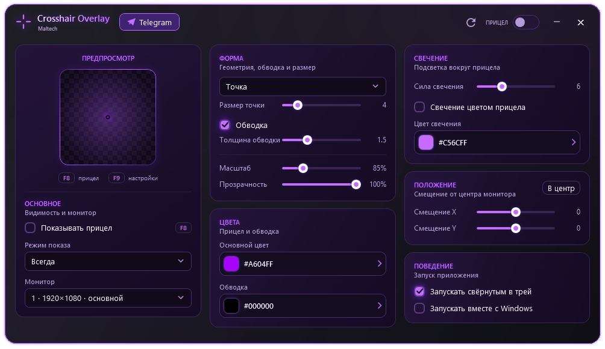

# Crosshair Overlay

A fast and free alternative to Hudsight and Crosshair X

 

> lightweight  – requires ~70 MB of RAM when the interface is hidden

## Features

- 🎨 **Advanced Color Picker** — Choose colors using an interactive HSV palette, adjustment sliders, or raw HEX/RGB values
- 🖥️ **Smart Fullscreen Mode** — Auto-hides when you Alt-Tab and shows up only when the game is active
- ⚡ **Zero-Impact Performance** — Native C# architecture with 0% FPS drop, in-game hotkeys (F8/F9), and tray minimization

## Screenshots

## Installation

Choose your preferred version from **[Releases](https://github.com/Maltarro/Crosshair-Overlay/releases/tag/Release)**:

*   **Portable:** Download the `.zip` archive, unpack it anywhere, and run `CrosshairOverlay.exe`.
*   **Installer:** Download the `.exe` setup file and follow the installation wizard.

## Author

## License

MIT -- see [LICENSE](LICENSE) for details.
